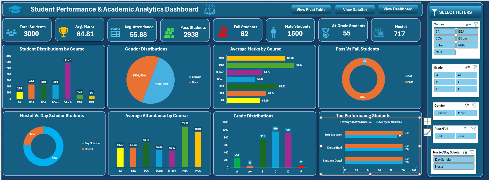
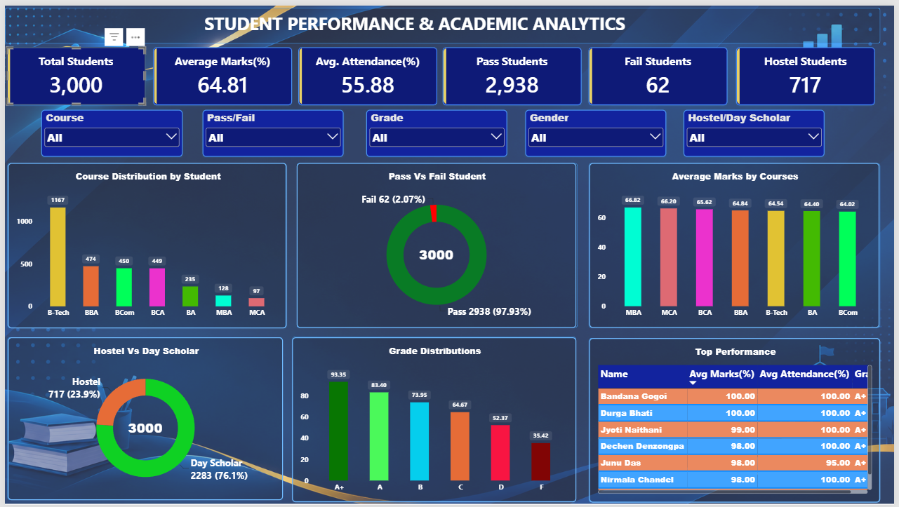
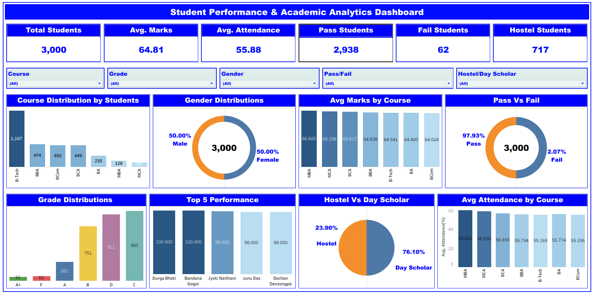

Student Performance & Academic Analytics Dashboard

 Project Overview

The Student Performance & Academic Analytics Dashboard is an end-to-end Data Analytics project developed using three popular Business Intelligence and Data Visualization tools: Microsoft Excel, Power BI, and Tableau.

The project focuses on analyzing student academic performance, attendance, course distribution, grades, gender distribution, pass/fail rates, and hostel statistics.

Using a dataset of 3,000 student records, this project transforms raw student data into meaningful insights through interactive dashboards and visualizations.

🎯 Project Objectives
- Analyze overall student academic performance.
- Evaluate course-wise student distribution.
- Monitor average marks and attendance.
- Identify pass and fail student statistics.
- Analyze grade-wise student performance.
- Compare male and female student distribution.
- Analyze Hostel vs Day Scholar students.
- Identify the Top 5 performing students.
- Build interactive dashboards using three different BI tools.

 Tools & Technologies
   Microsoft Excel : Data Analysis, Pivot Tables, Pivot Charts & Slicers.
   Power BI : Data Visualization, Power Query, DAX & Interactive Dashboards.
   Tableau : Data Visualization, Calculated Fields, Filters & Interactive Dashboards .

🌐 Live Interactive Dashboards
Explore the live dashboards developed using Power BI and Tableau.

1. Power BI Dashboard
[🚀 View Live Power BI Dashboard](https://app.powerbi.com/view?r=eyJrIjoiNjdlMzNjNzAtOGQ4Mi00NjE2LTg5MGEtNTU4ZjU5OTdjNDVjIiwidCI6IjUxZmQ2M2E1LTMyM2UtNGVjNi04ODhhLWQ5NmZhMWJmNWZlMyJ9)

2. Tableau Dashboard
[📊 View Live Tableau Dashboard](https://public.tableau.com/app/profile/prince.kumar3670/viz/StudentPerformance_Dashboard/Student_performance_Dashboard)

3. Microsoft Excel Dashboard
The Excel dashboard file is available in the Excel folder of this repository.

📊 Dashboard Features
1. Microsoft Excel Dashboard
- Interactive KPI Cards
- Course-wise Student Distribution
- Gender Distribution
- Average Marks by Course
- Pass vs Fail Analysis
- Hostel vs Day Scholar Analysis
- Grade Distribution
- Average Attendance by Course
- Top Performing Students
- Interactive Slicers

2. Power BI Dashboard
- Dynamic KPI Cards using DAX Measures
- Course Distribution Analysis
- Pass vs Fail Student Analysis
- Average Marks by Course
- Grade Distribution
- Hostel vs Day Scholar Analysis
- Top 5 Performing Students
- Attendance Analysis
- Interactive Slicers and Filters

3. Tableau Dashboard
- Student Performance KPI Cards
- Course-wise Student Distribution
- Gender Distribution
- Average Marks by Course
- Pass vs Fail Analysis
- Grade Distribution
- Hostel vs Day Scholar Analysis
- Top 5 Performing Students
- Average Attendance by Course
- Interactive Filters

Key Performance Indicators (KPIs)

Total Students : 3,000 
Average Marks : 64.81% |
Average Attendance : 55.88% 
Pass Students : 2,938 
Fail Students : 62 
Hostel Students : 717 
Pass Percentage : 97.93% 
Fail Percentage : 2.07% 

Note: KPI values represent the overall dataset. Individual dashboard values may change when interactive filters are applied.

#Key Insights
- A total of 3,000 student records were analyzed.
- 2,938 students passed, while 62 students failed.
- The overall pass percentage is approximately 97.93%.
- B-Tech has the highest student enrollment.
- Male and Female students have an equal distribution.
- Day Scholar students represent the majority of the student population.
- Course-wise marks and attendance help identify academic performance patterns.
- Grade distribution provides insights into students' academic achievements.

💡 Skills Demonstrated
- Data Cleaning and Data Analysis
- Microsoft Excel
- Pivot Tables and Pivot Charts
- Power Query
- DAX Measures
- Tableau Calculated Fields
- Data Visualization
- Interactive Dashboard Development
- KPI Development
- Business Intelligence
- Data Storytelling

Project Outcome
Successfully developed the same Student Performance & Academic Analytics project using three different BI tools: Microsoft Excel, Power BI, and Tableau.
This project demonstrates the ability to analyze student data, create meaningful visualizations, develop interactive dashboards, and communicate insights effectively.

👨‍💻 Author
Prince Kumar
Aspiring Data Analyst
Skills: Excel | SQL | Power BI | Tableau | Data Analytics

⭐ If you find this project useful, feel free to explore the dashboards and share your feedback.

Excel Dashboard View

Power BI Dashboard View

Tableau Dashboard View

